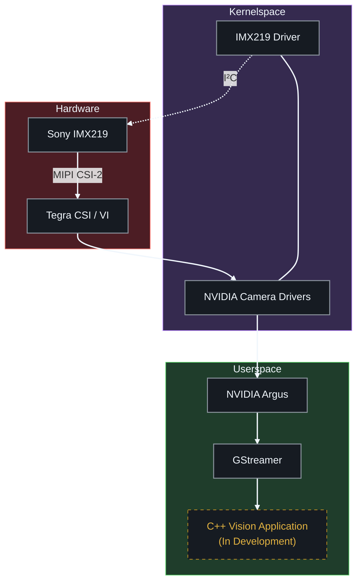

# Jetson Embedded Vision

Embedded Linux computer vision project built on the NVIDIA Jetson Nano, focusing on Linux camera driver development, MIPI CSI-2 image acquisition, and hardware-accelerated video processing.

## Overview

This project explores the embedded Linux camera stack, from sensor configuration and kernel driver development to userspace video applications.

The first development stage focuses on extending the Sony IMX219 driver with a custom **1024 × 768 @ 60 FPS** capture mode, integrating it into the NVIDIA camera stack, and validating capture through GStreamer.

Future development will focus on real-time video processing, hardware-accelerated streaming, and deployment.

## Hardware

* NVIDIA Jetson Nano Developer Kit (4GB, B01)
* Sony IMX219 Camera Module
* MIPI CSI-2 interface (2 lanes)

## Software

* NVIDIA Jetson Linux R32.7.6 (JetPack 4.6.6)
* Linux Kernel 4.9-tegra
* C / C++
* V4L2 / NVIDIA Argus
* GStreamer
* CMake

## Features

### Completed

**IMX219 Camera Driver**
* Integrated and configured the IMX219 sensor driver.
* Implemented a custom 1024 × 768 @ 60 FPS capture mode.
* Updated sensor register tables and Device Tree configuration.
* Implemented vertical flip with the corresponding Bayer pattern adjustment.
* Validated image orientation, color reproduction, and sustained capture using GStreamer.
* Completed a five-minute capture test with 18,000 requested buffers.

### In Development

**Embedded Vision Application**
* C++ camera capture application using GStreamer.
* Hardware-accelerated H.264 encoding and UDP video streaming.
* Monocular depth estimation integration.

### Planned

* Yocto-based Linux image.
* Performance benchmarking.
* Automated testing.

## Architecture

